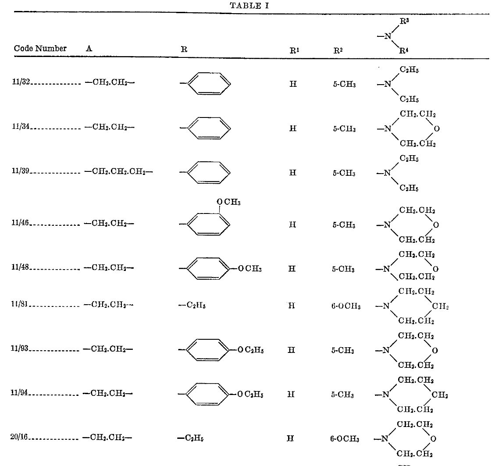
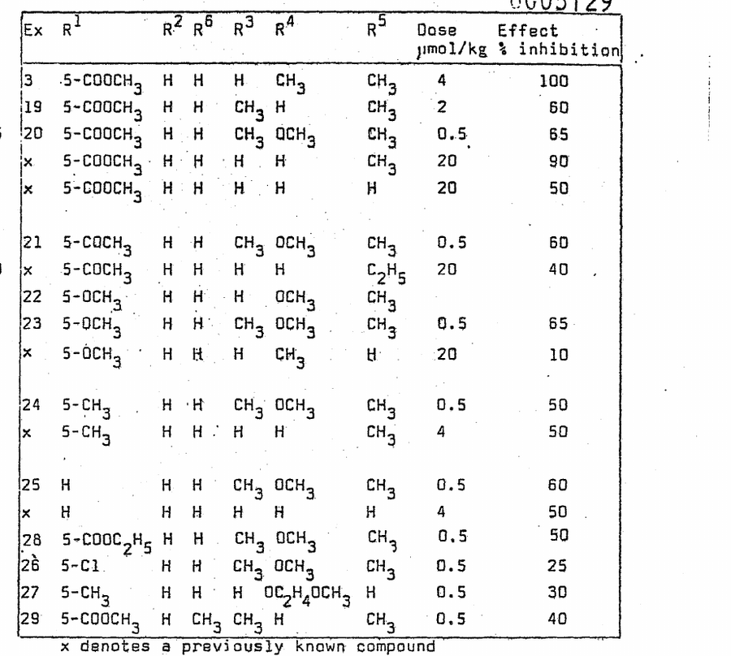

# The Hässle codes in patents

[Field note 4](04-hassle-what-we-learned.html) ended with Losec. Its code, H 168/68, could not be tied to
Hässle from open records without patents, and I had chosen not to count patents. That was the next thing to
dig into.

Then [Chris Southan](https://www.linkedin.com/in/cdsouthan/) called. Patents are his field. Before the call I
wrote him an overview of how the codes had been taken from patents so far. After it, he pointed me to his post
[ACS Fall 2026 First disclosures: PubChem and patent mappings](https://cdsouthan.blogspot.com/2026/09/acs-fall-2026-first-disclosures-in.html).
He starts from a code and a structure and goes to the patents through PubChem. My case is the opposite: old
patents with codes, and few structures anyone has linked to them. So this note is about patents, as a source
for codes.

## What was done

- **Two code tables transcribed.** Two AB Hässle patents by Brändström and S.Å.I. Carlsson print the codes
  without the "H", in a column headed "Code Number": [US 3485835](https://patents.google.com/patent/US3485835A/en)
  (52 benzofurans, filed 1968) and [US 3558616](https://patents.google.com/patent/US3558616A/en)
  (24 benzothiophenes, filed 1969). The OCR text is unusable for these tables, so every row was copied from the
  page images and checked against them again.
- **Structures built** for 75 of the 76 codes, from the generic formula plus the substituents of each row. One
  row (H 43/49) is printed without the branch it needs.
- **PubChem**, following Chris's method: exact structure, salt records with the same parent, PubChem's patent
  mappings, and a name search per submitter record for all codes.
- **Patent families from the EPO.** With [EPO Open Patent Services](https://ops.epo.org) the families of the
  known patents, and the page images of chosen members, read by eye.
- **The omeprazole filings**: the 1979 European filing and the 1975 German one it cites.

<figure>

<figcaption>US 3485835 (AB Hässle, filed 1968-04-10), Table I, first rows. The "Code Number" column prints the
codes without the "H": 11/32 is H 11/32. Each row is one compound, given by the substituents of the generic
formula. The fourth row, H 11/46, is one of the two rows I first read as ortho (learning 5). Page image from
the Google Patents PDF.</figcaption>
</figure>

Everything is in the repository: the [inputs](repo:hassle_codes/inputs/), with a findings file per session,
and the [PubChem notebook](repo:hassle_codes/notebooks/hassle_pubchem_patents.ipynb).

## What I learned

**1. For most of these compounds the patent is the only public link between code and structure.** Of the 75
structures built, 6 are in PubChem. None of the 6 carries its code. The name search found 47 codes with a
submitter record carrying the code as a name, the earliest deposited in 2005. None of them is one of the 76
table codes. For those, nobody has linked the code to a structure.

**2. Code and structure printed together is the exception.** I checked four families page by page:

- The 1965 family (Swedish priority SE 7128/65): eight members published 1966–69, in Belgium, the
  Netherlands, France, Spain, Austria, Britain and Norway. They print the same compound tables, with no code
  column. The codes appear first in the two US filings of 1969.
- The 1971 zimelidine family (SE 5496/71): the codes are printed in the Swedish, Belgian, French, Dutch,
  British and US members. The German member, [DE 2220333](https://patents.google.com/patent/DE2220333A1/en),
  numbers the compounds instead.
- The omeprazole filing of 1979 and the benzimidazole filing of 1975 print no codes at all.

So there is no Hässle rule. A code table is a lucky find.

**3. A code's first appearance dates the patent text, not the compound.** The benzothiophenes were published
in 1966. Their codes were published in 1969. The latest-possible date of those 24 codes stays 1969-11-10.

**4. Codes can enter a family late.** Five codes not in my lists appear first in the Belgian filing
[BE 781105](https://patents.google.com/patent/BE781105A/en) of 1972, each with a drawn structure:
H 102/01, H 102/04, H 102/30, H 94/94 and H 99/68. They are not in the Swedish text. So the large list grew
from 138 to 143 codes. One of them, H 102/01, is the first second number below 03.

**5. The scan decides.** Two benzofuran rows were read as ortho and are meta: H 11/46 is 3-methoxyphenyl,
H 26/38 3-chlorophenyl. In these drawings the position is easy to misread. A second print of the
benzothiophene table, [US 3594478](https://patents.google.com/patent/US3594478A/en), agrees in all 24 rows,
including a conflict for H 53/84 that is in both prints. And Google Patents is not the printed page. For
[DE 2548340](https://patents.google.com/patent/DE2548340A1/en) it gives a publication date, a Swedish priority
and an inventor's name that the printed cover does not have.

**6. A patent mapping is a link, not ownership.** PubChem maps three of the benzofurans to a 2013 patent
application from Imperial Innovations, priority 2011. The compounds are from 1968. The mapping says the
structure is in that text, nothing about who owned the code.

**7. Submitter dates show who first named a structure.** This is Chris's point, and it held here too. A
compound record gets its date from the first structure deposited, often from patent extraction. The name comes
later, from another depositor. Only the submitter records show who put the code on the structure, and when.
Spelling matters for the search: H 149/94 is found only as "H-149/94", H 29/50 only as "H 29-50".

**8. The answer on Losec.** The 1979 European filing, [EP 0005129](https://patents.google.com/patent/EP0005129A1/en),
has omeprazole as Example 23 and in claim 7, with Aktiebolaget Hässle as applicant. It does not print
H 168/68. The examples go by number. The German filing it cites, DE 2548340 of 1975, is the same. The
Swedish application of 1978 has no page images in the EPO service. So the patents tie the compound to Hässle,
but never the code.

<figure>

<figcaption>EP 0005129 A1 (Aktiebolaget Hässle, published 1979-10-31), p. 18, Table 2 continued. Example 23
(R¹ 5-OCH₃, R³ CH₃, R⁴ OCH₃, R⁵ CH₃) is omeprazole. The compounds go by example number; "x" marks a
previously known compound. No H codes. Page image from EPO Open Patent Services.</figcaption>
</figure>

## The decision on H 168/68

The company for H 168/68 now rests on two records, not one. The code names the compound in sources that
anyone can check, the earliest a PubMed record from 1983. The compound is claimed by AB Hässle in the 1979
filing. I have decided that this is enough. On 27 November Hässle AB was added as the company on the
[H 168/68 statement](https://www.wikidata.org/wiki/Q422210#P15001), with the patent as a second
reference next to the PubMed record. It is a step from the bar in note 4, where the company was left out
unless one record showed it. For Losec I think two records that each can be checked are better than a gap.

## The numbers

The [historical list](repo:collections/hassle_h_codes_all.csv) now has 143 codes, each with its sources and
its earliest date. 86 of them are known only from patents. The
[Wikidata list](repo:collections/hassle_h_codes_wikidata.csv) still has 18 codes. 4 of them now say who
conferred the code. The decision for H 168/68 is D16 on the [publication decisions](../decisions.html) page,
and the edit is recorded in [`wikidata/batches/`](repo:wikidata/batches/hassle_h_16868_p1027_20261127.csv).
The findings behind this note are in
[`hassle_findings_2026-11-26.csv`](repo:hassle_codes/inputs/hassle_findings_2026-11-26.csv) and
[`hassle_findings_2026-11-27.csv`](repo:hassle_codes/inputs/hassle_findings_2026-11-27.csv), with a source for
every value.

## Open

- The questions to Chris: codes added at a later filing or left out of one member, whether such code tables
  were common in other companies at that time, whether PubChem and SureChEMBL extract the tables of
  patents this old, and whether we should deposit the code-to-structure links ourselves.
- The Swedish applications, through the Swedish patent office.
- How the numbers were given. The patents show that the code is given per isolated substance and that close
  analogues sit on neighbouring numbers. They do not show what the number encodes. Hässle's archive at
  Riksarkivet in Göteborg is still the place to ask.

If you worked at Hässle, or know how the codes were given, I would still very much like to hear from you.

This work was done together with Claude (Anthropic): transcription from page images, the notebooks, and
checking each finding against its source.
